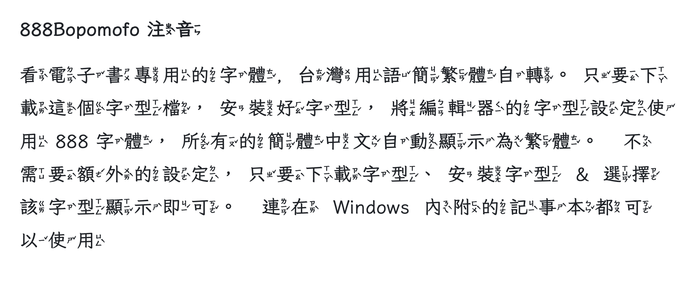
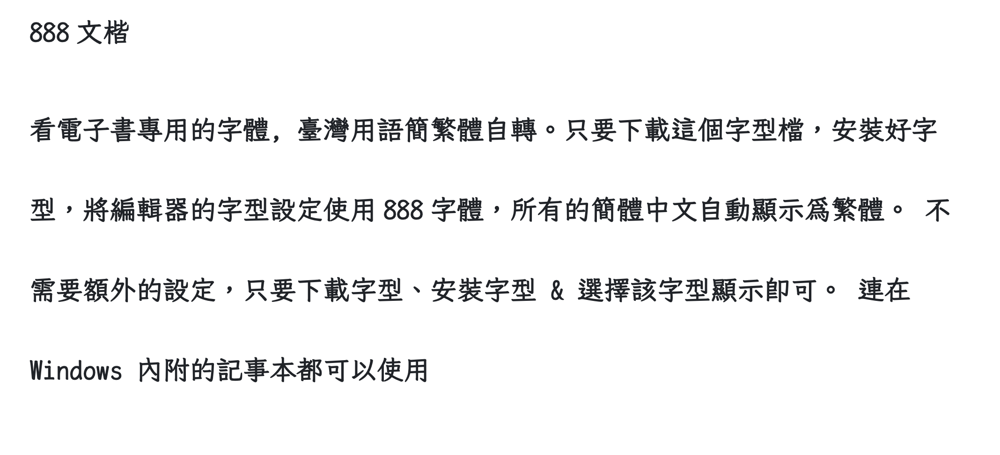
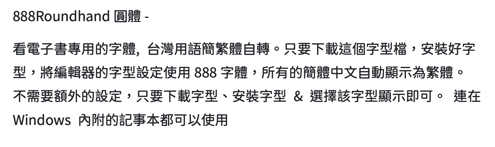
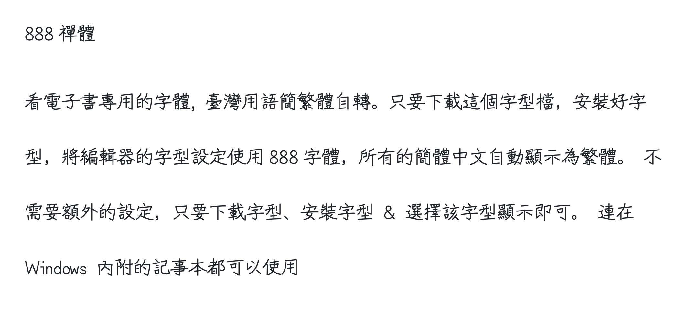

# 888 系列繁體字型 (簡體自動顯示為繁體)

只要下載並安裝這些字型，在編輯器或閱讀器中選擇使用，所有的簡體中文將自動顯示為繁體。無需額外設定，連 Windows 記事本也適用。

## 快速導覽
- [**888Bopomofo注音**](./888Bopomofo注音/README.md) - 基於 BpmfIansui（搭配 Noto Sans TC 補字），適合注音字型與台灣正體顯示。
- [**888Roundhand圓體**](./888Roundhand圓體/README.md) - 基於臺灣圓體（TaiwanPearl 2.125），適合一般閱讀。
- [**888禪體**](./888zen禪體/README.md) - 基於苦累蛙圓體（Kurewa Gothic 1.071，搭配 Noto Sans TC 補字），具備手寫風格。
- [**888可愛體**](./888cute可愛體/README.md) - 基於內海字體（NaikaiFont 1.89 TW），風格活潑。
- [**888文楷**](./888LXGW文楷/README.md) - 基於霞鶩文楷（LXGW WenKai 1.530），含比例寬與等寬版，極致的閱讀體驗。

## 更新紀錄與轉換規格
- **目前詞庫與規則**：已全面以 `OpenCC 1.4.2`（`--config s2tw`，不超翻、保留詞級消歧與台灣正體字形）與修復版 GSUB 管線重建，解決「后来／业余／发现／头发／皇后」等一對多與詞級轉換問題。
- 詳細變更紀錄請參閱 [CHANGELOG.md](./CHANGELOG.md)。

## 使用場景
- **電子書閱讀：** 電子閱讀器專用字體，解決一對多繁體轉換問題。
- **瀏覽器顯示：** 讓網頁簡體字自動變繁體。
- **創作開發：** 提供不轉換歧異字的版本，方便精確選字。
- **偽直排閱讀：** 各字族資料夾內的 `Rotated90偽直排` 版本適合舊型電子書設備。

## 下載位置
👉 [GitHub Releases 下載點](https://github.com/tbdavid2019/fonts-TW/releases)

---

## 效果展示

### 888Bopomofo注音

### 888文楷

### 888圓體

### 888禪體

### 888可愛體

---
#### 製作工具與教學
- **888 字型生成工具 (最新)** 採用自動化生成精靈：[tbdavid2019/OpenCCFontGenerator](https://github.com/tbdavid2019/OpenCCFontGenerator)（見 [FONT_PRODUCTION_WORKFLOW.md](./FONT_PRODUCTION_WORKFLOW.md)）
